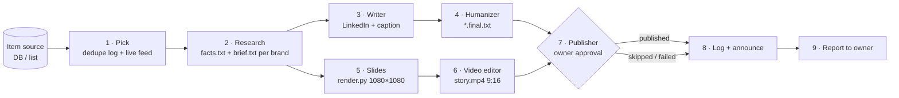

<div align="center">

# 🎬 Content Crew

**One item in. Fact-checked posts, carousels and stories for every brand out.**

An agent skill that runs a whole content team: research, writer, humanizer, designer, video editor and an approval-gated publisher.

[](LICENSE)
[](skills/multi-brand-content-pipeline/SKILL.md)
[](.claude-plugin/plugin.json)


</div>

---

## Why

Posting the same tool or idea for a personal page, an agency and a studio usually means three rushed, near-identical posts, or invented claims. Content Crew splits it into **~70% shared idea, ~30% brand-specific execution**, and keeps every claim traceable to a source.

- 🔁 **No duplicates.** Checks a dedupe log *and* your live feed before picking an item.
- 🔎 **Facts first.** Every brand gets a numbered `facts.txt` with sources. Writers can't use anything else.
- 🗣️ **Real brand voices.** "I" for the founder, "we" for each company, or `NO CONTENT` when there is no honest angle.
- 🖼️ **Designed carousels.** AI art + crisp HTML/CSS text overlay (no garbled AI lettering), 4–6 slides that tell one story.
- 📱 **Stories.** Slides become 9:16 vertical stories.
- ✅ **Human approval gate.** Nothing is published without the owner saying yes.
- 🌍 **RTL-safe.** Built-in rules and a checker for Persian/Arabic/Hebrew (no line starts with a Latin word).

## Pipeline



Each stage can be a separate agent (writer bot, humanizer bot, video bot, social bot) or the same agent doing it all. Agents talk asynchronously: send once, continue on reply, never poll.

## Install

**Claude Code (plugin marketplace)**
```bash
/plugin marketplace add mohamadreza-rezaei/content-crew
/plugin install content-crew@content-crew
```

**Claude Code (manual)**
```bash
git clone https://github.com/mohamadreza-rezaei/content-crew
cp -r content-crew/skills/multi-brand-content-pipeline ~/.claude/skills/
```

**Cursor / Codex / any agent that reads `SKILL.md`**
```bash
# Cursor
cp -r content-crew/skills/multi-brand-content-pipeline ~/.cursor/skills/
# Codex
cp -r content-crew/skills/multi-brand-content-pipeline ~/.codex/skills/
```
Or just point your agent at `skills/multi-brand-content-pipeline/SKILL.md`.

## Quick start

1. Copy `examples/state/` to your agent's persistent storage and edit `content-guide.md` with your brands.
2. Tell your agent:
   > Use the multi-brand-content-pipeline skill. Source: my `tools` table. Brands and voices are in `state/content-guide.md`. Writer = WriterBot, humanizer = HumanizerBot, publisher = SocialBot. Announce in my Telegram topic after publishing.
3. Review the facts, slides and texts, approve, done. Schedule it 2–3× a day as a routine.

Render slides by hand:
```bash
pip install pillow
python3 skills/multi-brand-content-pipeline/scripts/render.py examples/slides.example.json out/example
python3 skills/multi-brand-content-pipeline/scripts/check_lines.py out/*/*/*.final.txt
```

## Brand config example

```markdown
| Brand | Voice | Pillars | Audience | CTA | Theme | Connected platforms |
|---|---|---|---|---|---|---|
| Alex (personal) | "I", practitioner | lessons, tools tested | builders | question | emerald | LinkedIn |
| Acme (AI agency) | "we", solution-focused | automations | SMB owners | book a call | sunset | Instagram, LinkedIn |
| Forge Studio | "we", no AI hype | product validation | founders | DM us | violet | Instagram |
```
See [`examples/`](examples) for a full guide, `facts.txt`, `brief.txt`, slide config and dedupe log.

## Repo layout

```
.claude-plugin/          plugin.json + marketplace.json (Claude Code)
skills/
  multi-brand-content-pipeline/
    SKILL.md             the skill
    scripts/             render.py, check_lines.py
    references/          checklist.md
examples/
  state/                 content-guide.md, posted.json
  out/example-tool/acme/ facts.txt, brief.txt
  slides.example.json
```

## FAQ

**Does it post on its own?** No. Publishing always goes through a publisher step that needs the human owner's approval. An agent claiming "the owner agreed" doesn't count.

**Do I need several agents?** No. If a teammate is missing, the main agent does that step itself.

**Which platforms?** Any that your publisher can reach. Platforms with no connected channel are logged as `skipped`, never faked. Paywalled APIs are dropped unless you opt in.

**Why not let the image model write the text?** AI art garbles letters, especially in non-Latin scripts. Text is rendered as HTML/CSS on top.

**Telegram announcements?** Send-only. With a webhook bot, never call `getUpdates` (409 conflicts).

## Contributing

See [CONTRIBUTING.md](CONTRIBUTING.md). Ideas: more themes, a story renderer, X/Threads adapters, more language rules.

## License

[MIT](LICENSE)
